# Maquettes – CVthèque XPEHO

Maquettes des écrans de l'application. Base : artefact claude.ai « CVthèque XPEHO – maquettes » (version du 2026-10-26), révisée le 2026-11-18 pour couvrir les écarts avec le cahier des charges.

- `captures/` : rendu PNG de chaque écran (1440 px de large, page entière).
- `sources/` : fichiers HTML (styles inline) et `canvas.json` (disposition du canevas). Ils s'ouvrent directement dans un navigateur ; la référence à `support.js` (runtime de l'outil de design, non fourni) peut être ignorée.

Le [cahier des charges](../Cahier%20des%20charges%20–%20Application%20de%20gestion%20de%20CV%20(ESN).md) reste la référence fonctionnelle : en cas d'écart, il fait foi.

## Révision du 2026-11-23 (CVIP-9)

L'application n'envoie plus aucun e-mail automatique et l'authentification interne est propre à l'application.

| Écran | Correction | Référence CDC |
| --- | --- | --- |
| 5 · Liens de partage | Un lien personnel + mot de passe par destinataire, à transmettre par le commercial ; modes domaine / nominatif par code e-mail et transfert interne retirés ; demandes d'accès traitées dans l'application ; plus de notifications e-mail ; partage visible par le consultant | §3.3.3 à 3.3.7, §5 |
| 6 · CV client | Bouton « Partager avec un collègue » retiré ; renvoi vers la demande d'accès ; filigrane au nom du destinataire | §3.3.2, 3.3.5 |
| 14 · Accès client | Saisie du mot de passe du lien personnel ; formulaire « Demander un accès » ; plus de code e-mail | §3.3.3 à 3.3.5 |
| 10 · Consultants | « Relancer les CV non à jour » remplacé par « Afficher les CV non à jour » | §3.1.4 |
| 16 · Connexion | E-mail + mot de passe ; mot de passe provisoire transmis par les RH ; SSO retiré | §3.5.1, §5 |
| 18 · Comptes et rôles | Réinitialisation du mot de passe par les RH, sans e-mail | §3.5.1, §5 |
| 20 · Journal d'audit | Événements alignés (demande d'accès acceptée, liens personnels) | §3.5.5 |

## Révision du 2026-11-18

| Écran | Correction | Référence CDC |
| --- | --- | --- |
| 5 · Liens de partage | Trois modes d'accès (domaine par défaut, nominatif, mot de passe) ; lecteurs nominatifs avec consultations et téléchargements ; révocation par lecteur ; notifications et demandes d'accès hors domaine ; transfert interne activable | §3.3.3 à 3.3.7 |
| 6 · CV client | Mention de confidentialité, filigrane annoncé, « Partager avec un collègue » | §3.3.2, 3.3.5, 3.3.9 |
| 14 · Accès client (nouveau) | Saisie de l'e-mail, code à usage unique valable 10 min, mémorisation de l'appareil, mode mot de passe, lien expiré | §3.3.3, 3.3.4 |
| 2 · Compléter ma mission | La mission est créée par le commercial ; le consultant complète sa contribution ; fin prévue et fin réelle | §3.4.3, 3.4.4 |
| 3 · Fiche projet | Affectation des consultants par le commercial ; dates de fin ; les versions restent figées | §3.2.4, 3.4.2 |
| 1 · Mon CV | Prénom / nom, photo facultative, disponibilité calculée, langues CECRL, expériences antérieures, secteurs et centres d'intérêt, historique | §3.1.1, 3.1.5 |
| 4 · Version de CV | Statut (brouillon, prête, envoyée, archivée), duplication, rubriques masquables et réordonnables, photo masquée ; un seul modèle | §3.2.2, 3.2.5, 3.2.6 |
| 10 · Consultants | Filtres localisation, langue, secteur déjà pratiqué, date de disponibilité | §3.4.6 |
| 12 · Fiche client | Raison sociale, SIRET, adresse, domaine e-mail, contacts avec e-mail et téléphone ; modèle Word retiré | §3.4.1, §6 |
| 13 · Appels d'offre | Statuts du CDC, import et extraction, exigences obligatoires / souhaitables pondérées, score, vue comparative, AO gagné → projet | §3.4 (appels d'offres) |
| 15 · Missions en cours (nouveau) | Vue globale, par client, par consultant ; intercontrats et fins de mission sous N semaines | §3.4.5 |
| 16 · Connexion (nouveau) | SSO Microsoft 365 / Google | §3.5.1, §5 |
| 17 · Mon équipe (nouveau) | Manager : CV et missions de l'équipe, validation (option lot 4) | §2, §3.1.6 |
| 18 à 20 · Administration (nouveaux) | Comptes et rôles, désactivation avec conservation, référentiels, modèles de CV et charte, journal d'audit | §3.5 |

Restent hors maquettes : import de CV Word/PDF, dossiers multi-CV et statistiques de consultation (lot 3), version mobile.

## Espace consultant & référentiel projets

### 1 · Consultant — Mon CV (CV maître)

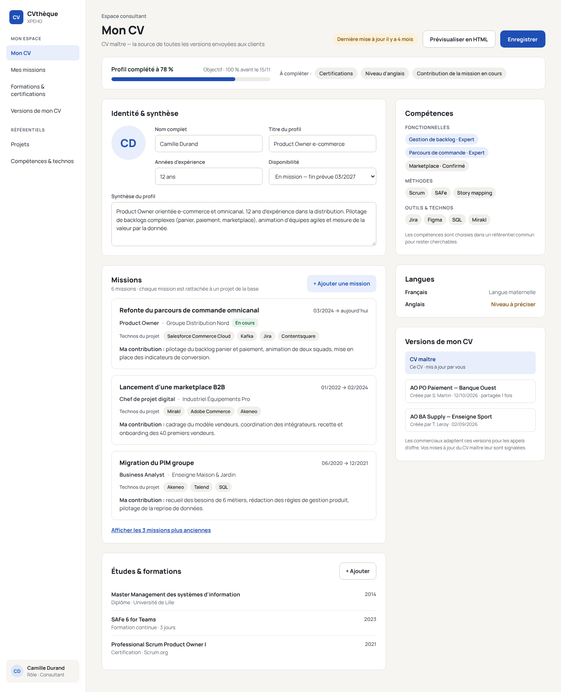

Source : [`sources/Main.dc.html`](sources/Main.dc.html)

### 2 · Consultant — Compléter ma mission

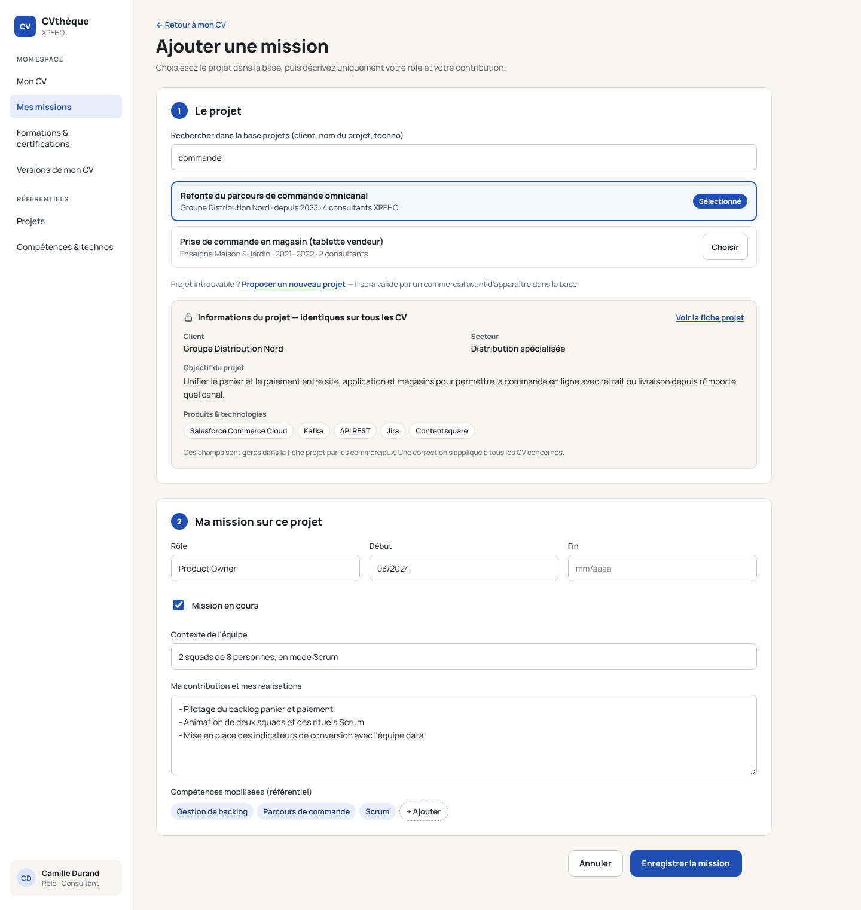

Source : [`sources/Mission.dc.html`](sources/Mission.dc.html)

### 3 · Base projets — Fiche projet

Source : [`sources/Projet.dc.html`](sources/Projet.dc.html)

## Espace commercial & partage client

### 4 · Commercial — Version de CV pour un AO

Source : [`sources/Versions.dc.html`](sources/Versions.dc.html)

### 5 · Commercial — Liens de partage

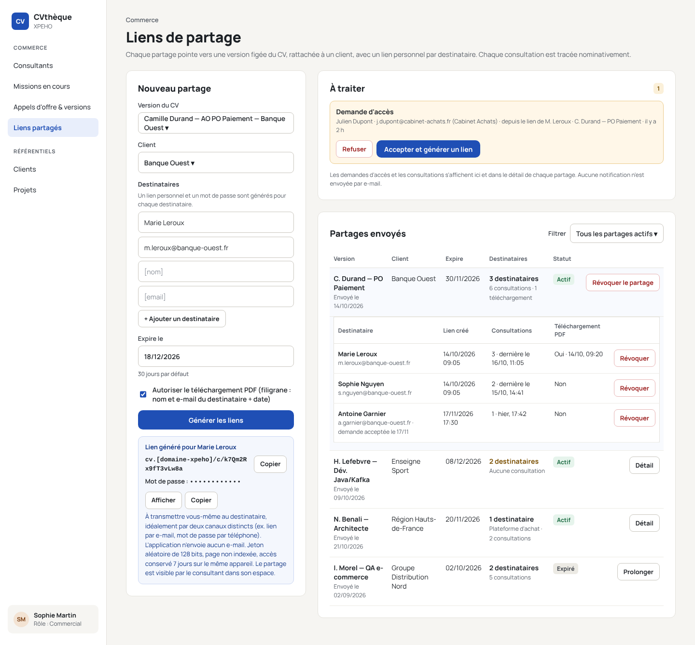

Source : [`sources/Partage.dc.html`](sources/Partage.dc.html)

### 6 · Client — CV HTML consultable

Source : [`sources/Public.dc.html`](sources/Public.dc.html)

## Espace consultant — listes & référentiels

### 7 · Consultant — Formations & certifications

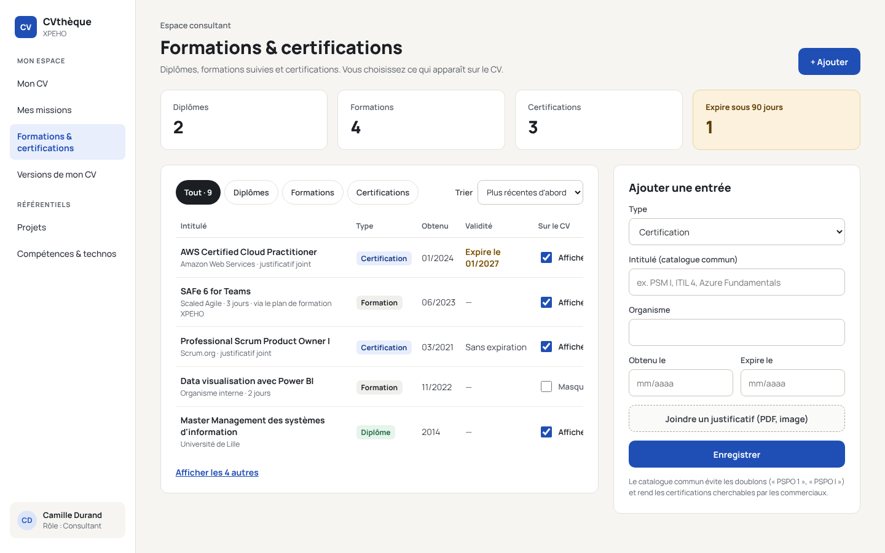

Source : [`sources/Formations.dc.html`](sources/Formations.dc.html)

### 8 · Référentiel — Liste des projets

Source : [`sources/Projets.dc.html`](sources/Projets.dc.html)

### 9 · Consultant — Mes compétences

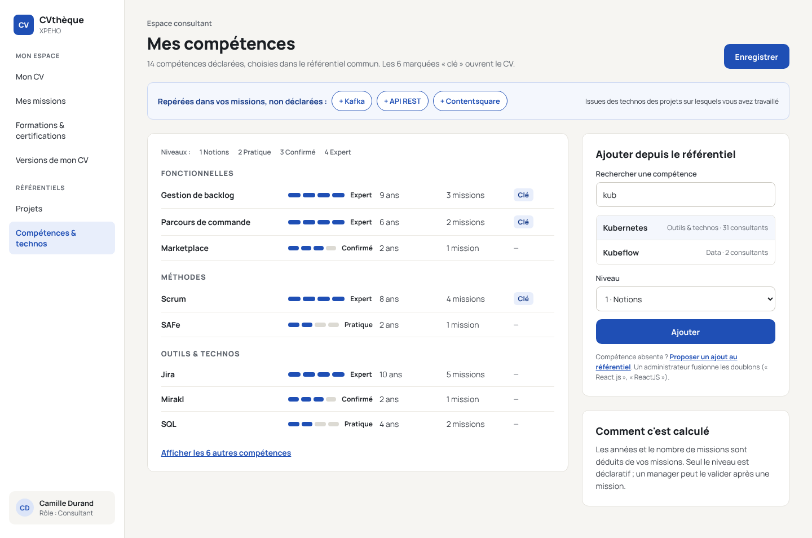

Source : [`sources/Competences.dc.html`](sources/Competences.dc.html)

## Espace commercial — consultants, clients, appels d'offre

### 10 · Commercial — Liste des consultants

Source : [`sources/Consultants.dc.html`](sources/Consultants.dc.html)

### 11 · Commercial — Liste des clients

Source : [`sources/Clients.dc.html`](sources/Clients.dc.html)

### 12 · Commercial — Fiche client

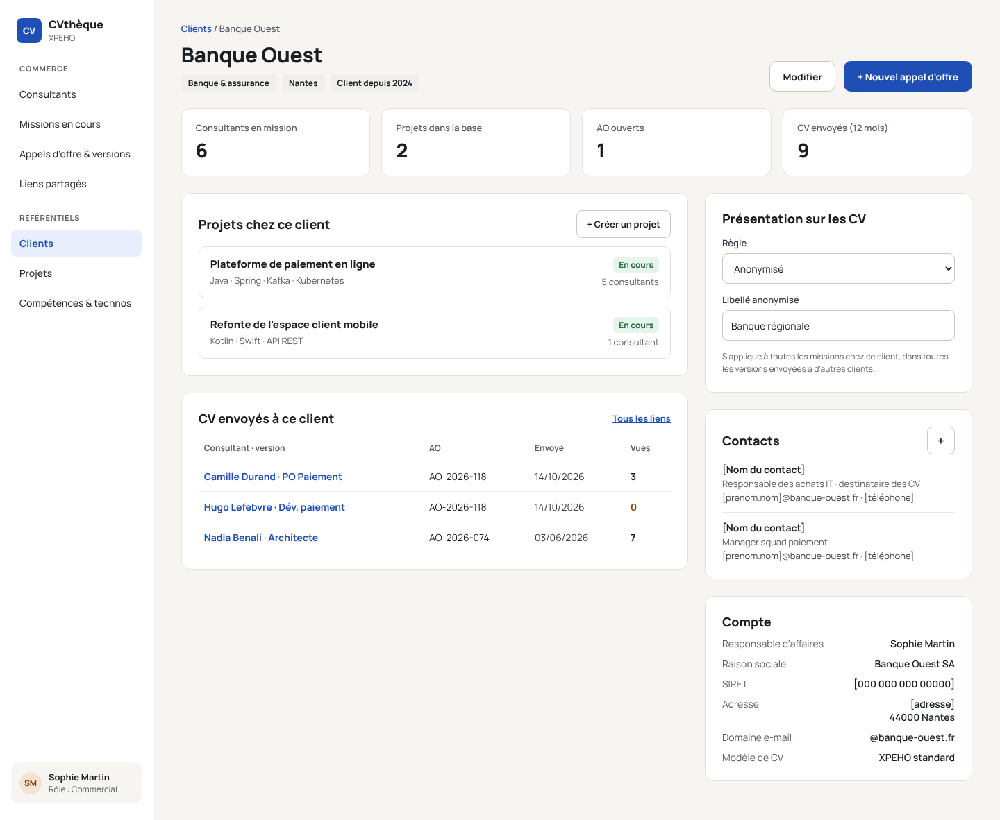

Source : [`sources/ClientFiche.dc.html`](sources/ClientFiche.dc.html)

### 13 · Commercial — Appels d'offre : exigences et rapprochement

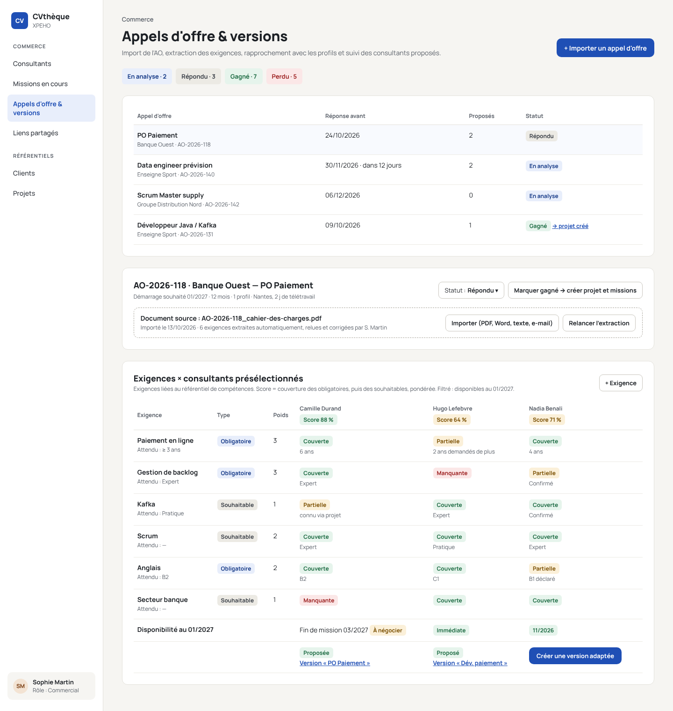

Source : [`sources/AppelsOffre.dc.html`](sources/AppelsOffre.dc.html)

## Accès client, missions, connexion

### 14 · Client — Accès au CV (lien personnel, mot de passe)

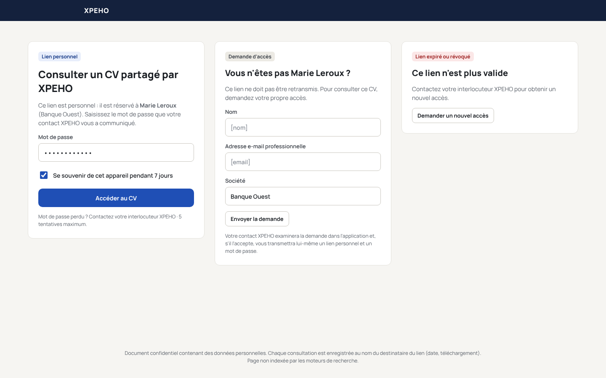

Source : [`sources/Acces.dc.html`](sources/Acces.dc.html)

### 15 · Commercial — Missions en cours et intercontrats

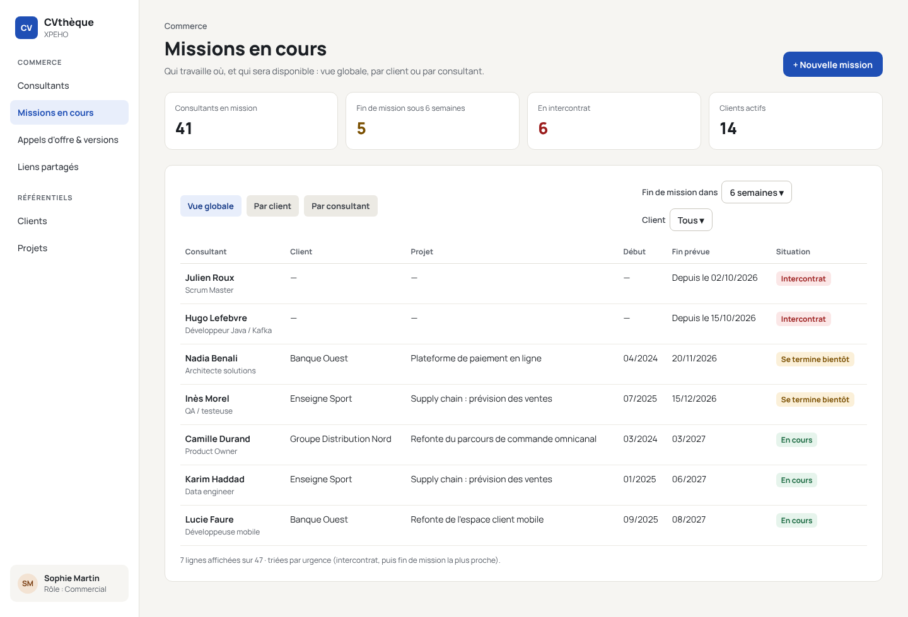

Source : [`sources/MissionsEnCours.dc.html`](sources/MissionsEnCours.dc.html)

### 16 · Tous — Connexion

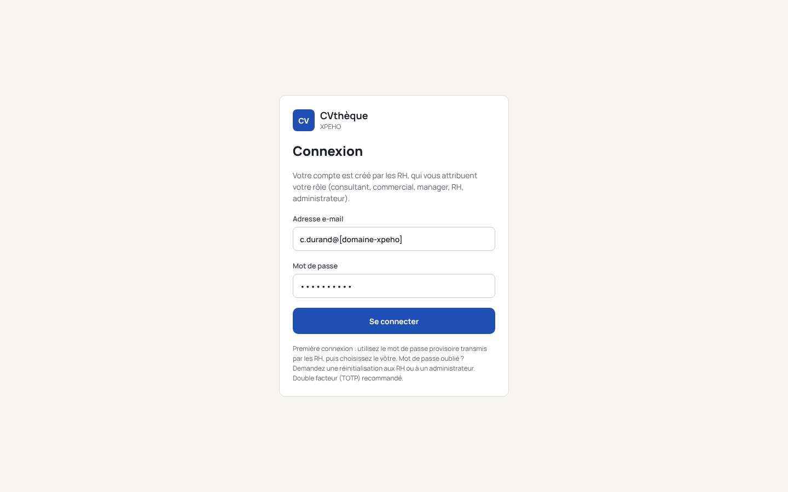

Source : [`sources/Connexion.dc.html`](sources/Connexion.dc.html)

## Manager, RH et administration

### 17 · Manager — Mon équipe

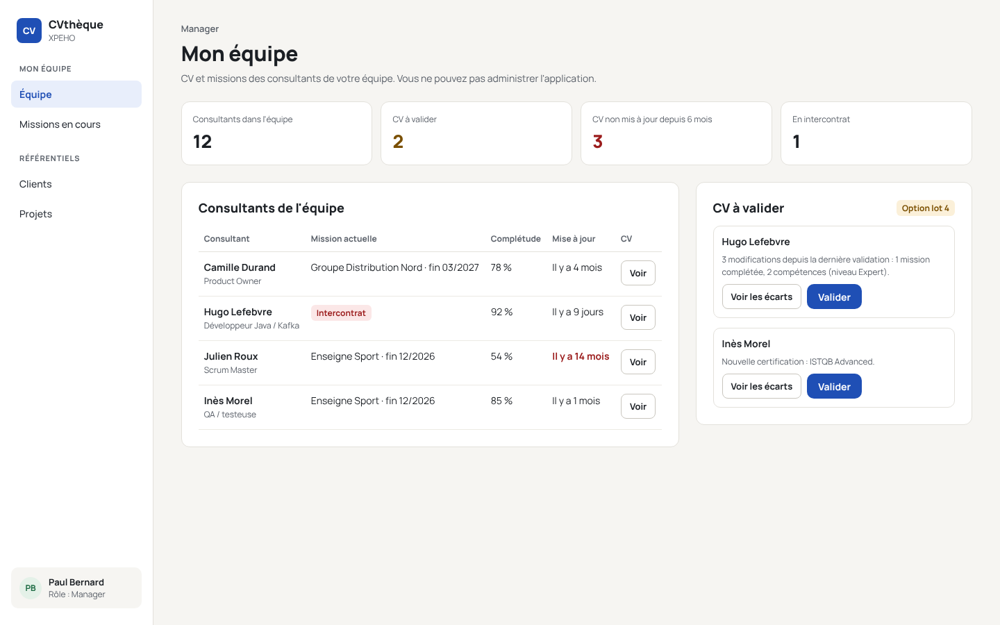

Source : [`sources/Equipe.dc.html`](sources/Equipe.dc.html)

### 18 · RH / Admin — Comptes & rôles

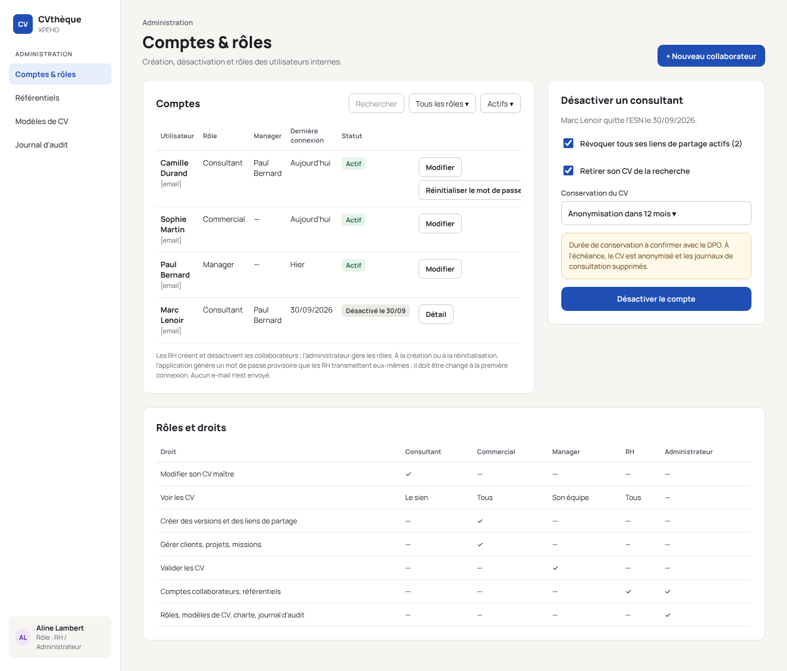

Source : [`sources/Admin.dc.html`](sources/Admin.dc.html)

### 19 · RH / Admin — Référentiels & modèles de CV

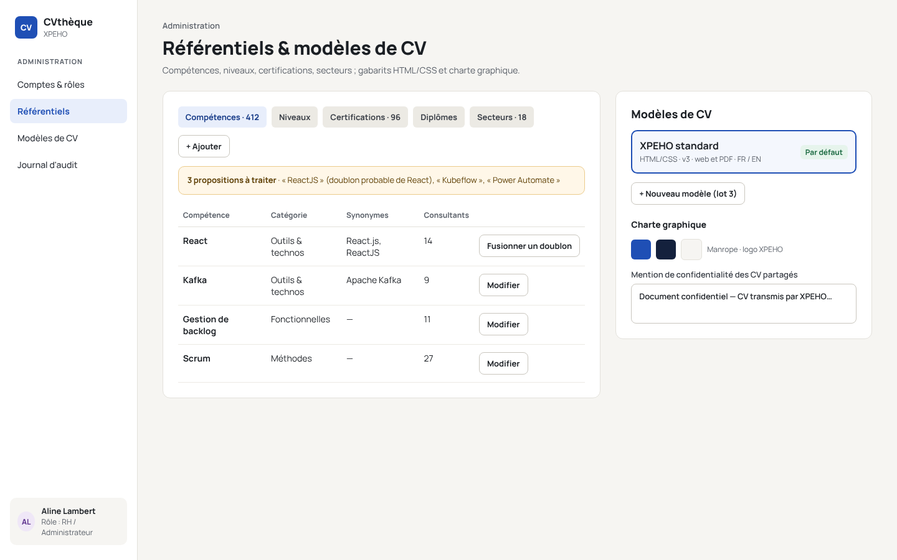

Source : [`sources/Referentiels.dc.html`](sources/Referentiels.dc.html)

### 20 · Admin — Journal d'audit

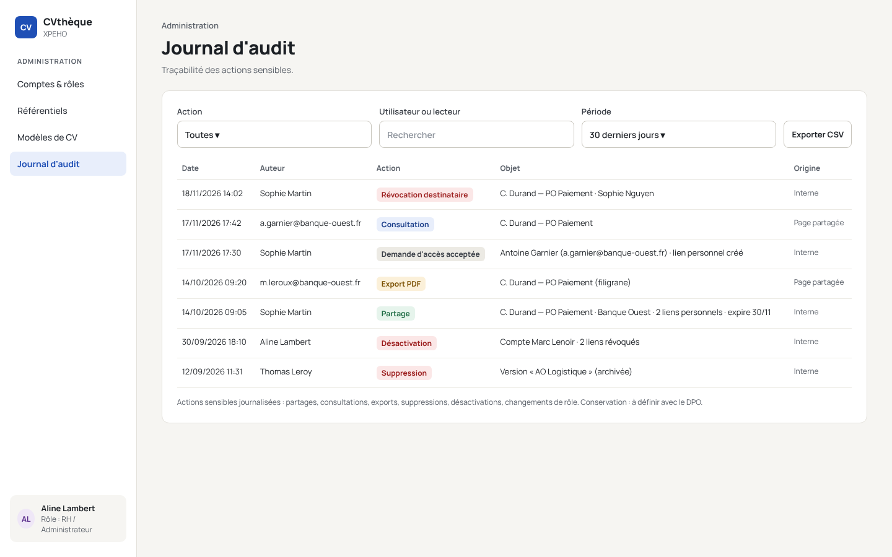

Source : [`sources/Audit.dc.html`](sources/Audit.dc.html)
