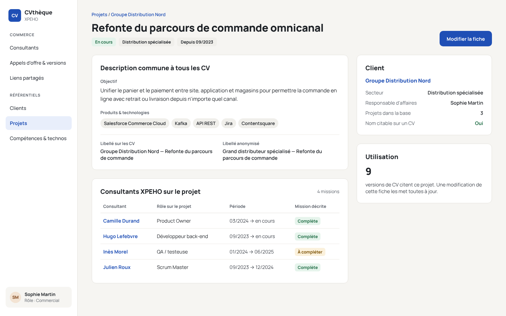
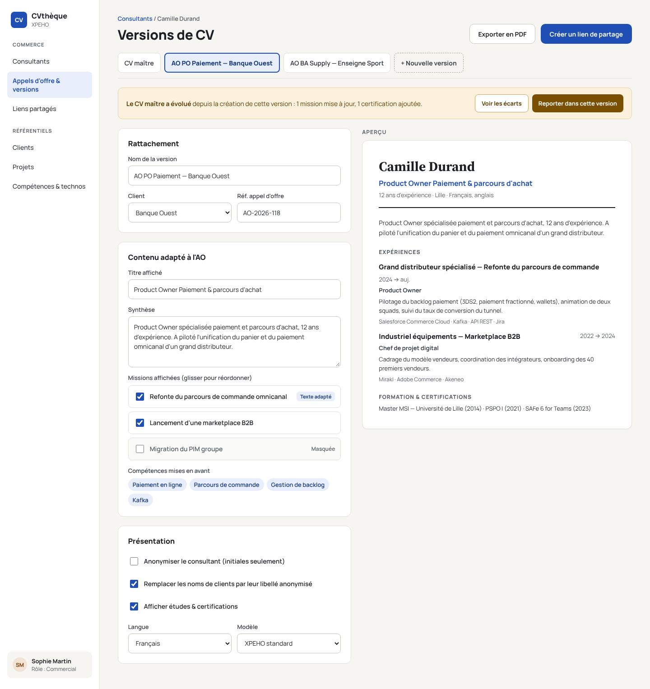
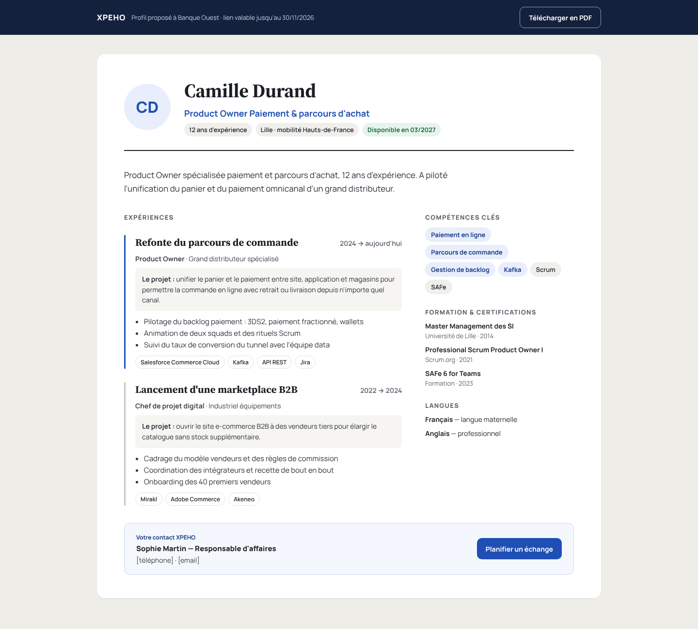
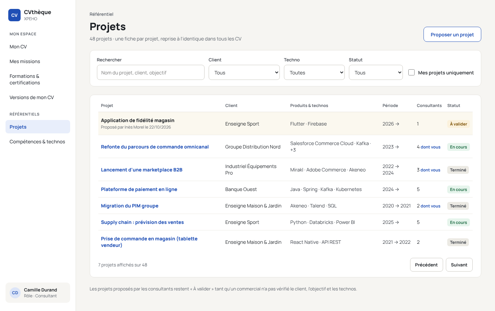
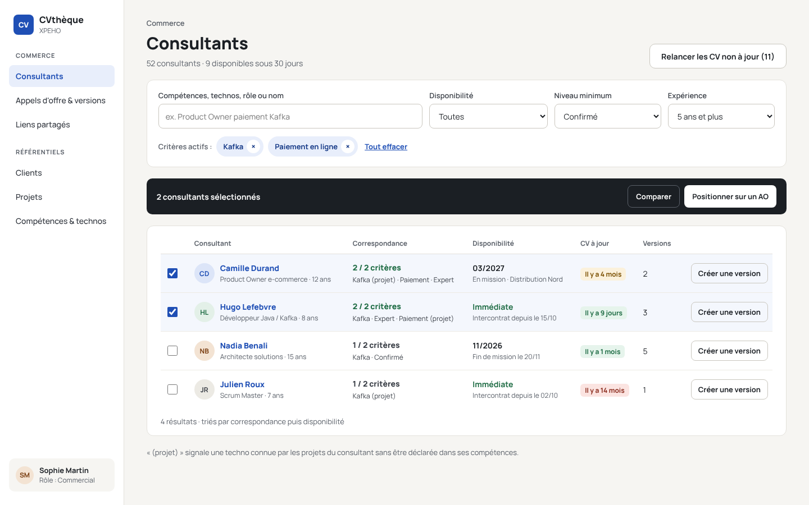
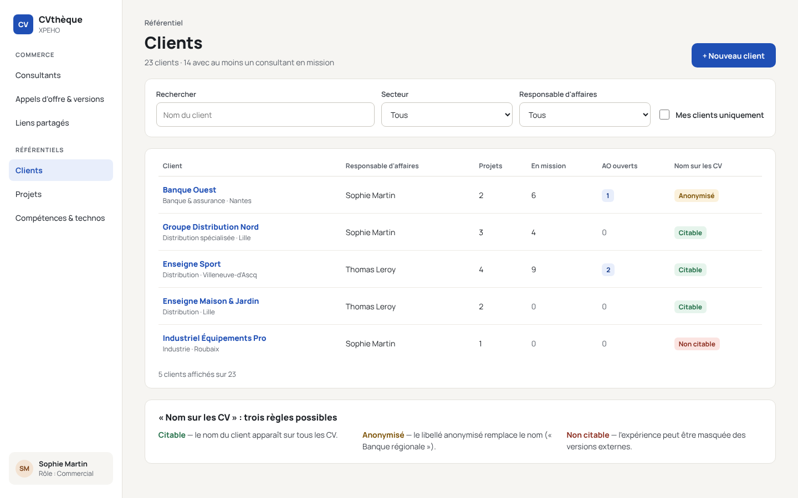

# Maquettes – CVthèque XPEHO

Maquettes des écrans de l'application, issues de l'artefact claude.ai « CVthèque XPEHO – maquettes » (version du 2026-10-26).

- `captures/` : rendu PNG de chaque écran (1440 px de large, page entière).
- `sources/` : fichiers HTML d'origine (styles inline) et `canvas.json` (disposition du canevas). Ils s'ouvrent directement dans un navigateur ; la référence à `support.js` (runtime de l'outil de design, non fourni) peut être ignorée.

Le [cahier des charges](../Cahier%20des%20charges%20–%20Application%20de%20gestion%20de%20CV%20(ESN).md) reste la référence fonctionnelle : en cas d'écart, il fait foi.

## Espace consultant & référentiel projets

### 1 · Consultant — Mon CV (CV maître)

Source : [`sources/Main.dc.html`](sources/Main.dc.html)

### 2 · Consultant — Ajouter une mission

Source : [`sources/Mission.dc.html`](sources/Mission.dc.html)

### 3 · Base projets — Fiche projet

Source : [`sources/Projet.dc.html`](sources/Projet.dc.html)

## Espace commercial & partage client

### 4 · Commercial — Version de CV pour un AO

Source : [`sources/Versions.dc.html`](sources/Versions.dc.html)

### 5 · Commercial — Liens de partage

Source : [`sources/Partage.dc.html`](sources/Partage.dc.html)

### 6 · Client — CV HTML consultable

Source : [`sources/Public.dc.html`](sources/Public.dc.html)

## Espace consultant — listes & référentiels

### 7 · Consultant — Formations & certifications

Source : [`sources/Formations.dc.html`](sources/Formations.dc.html)

### 8 · Référentiel — Liste des projets

Source : [`sources/Projets.dc.html`](sources/Projets.dc.html)

### 9 · Consultant — Mes compétences

Source : [`sources/Competences.dc.html`](sources/Competences.dc.html)

## Espace commercial — consultants, clients, appels d'offre

### 10 · Commercial — Liste des consultants

Source : [`sources/Consultants.dc.html`](sources/Consultants.dc.html)

### 11 · Commercial — Liste des clients

Source : [`sources/Clients.dc.html`](sources/Clients.dc.html)

### 12 · Commercial — Fiche client

Source : [`sources/ClientFiche.dc.html`](sources/ClientFiche.dc.html)

### 13 · Commercial — Appels d'offre & versions

Source : [`sources/AppelsOffre.dc.html`](sources/AppelsOffre.dc.html)
